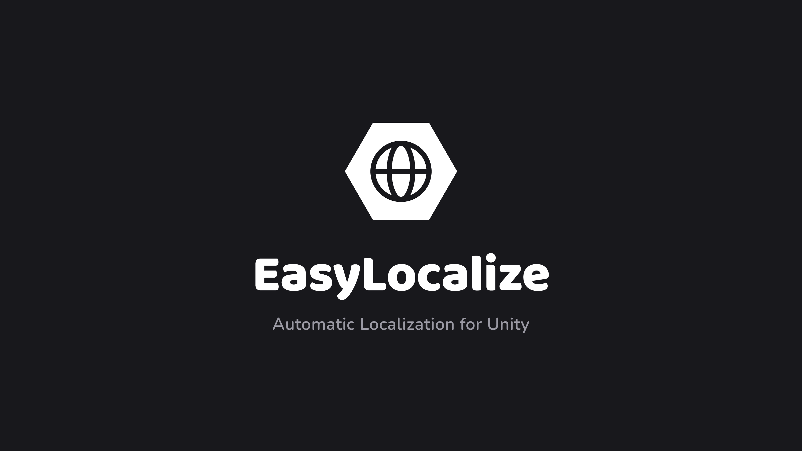
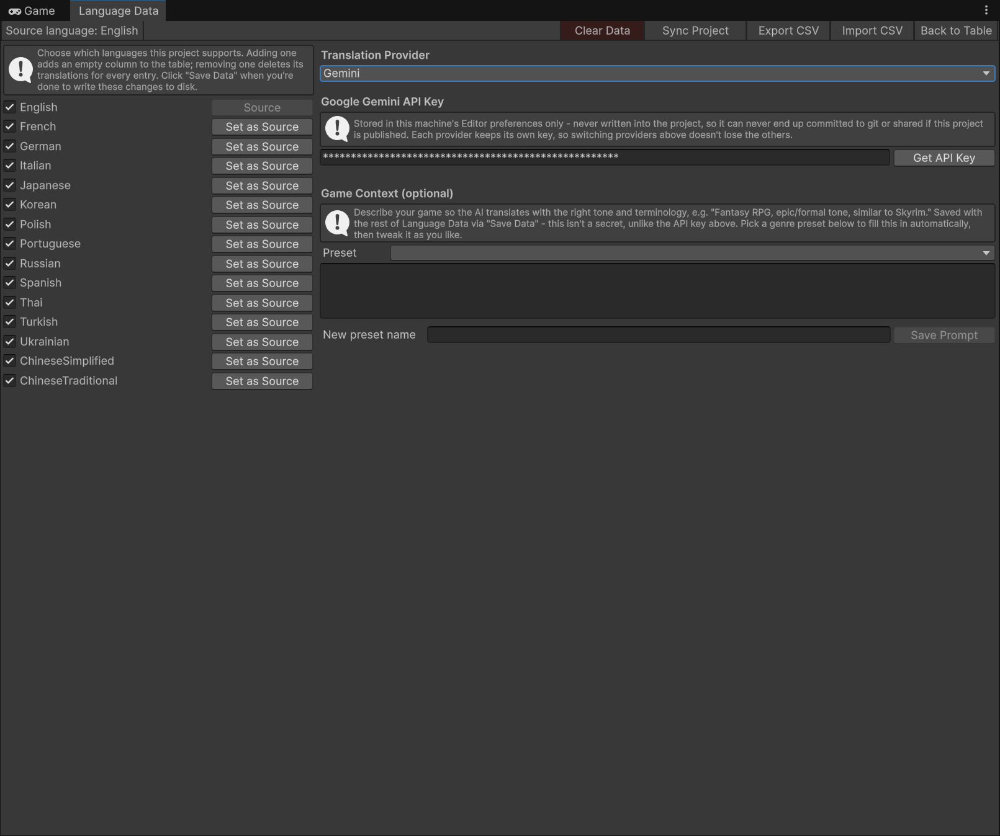
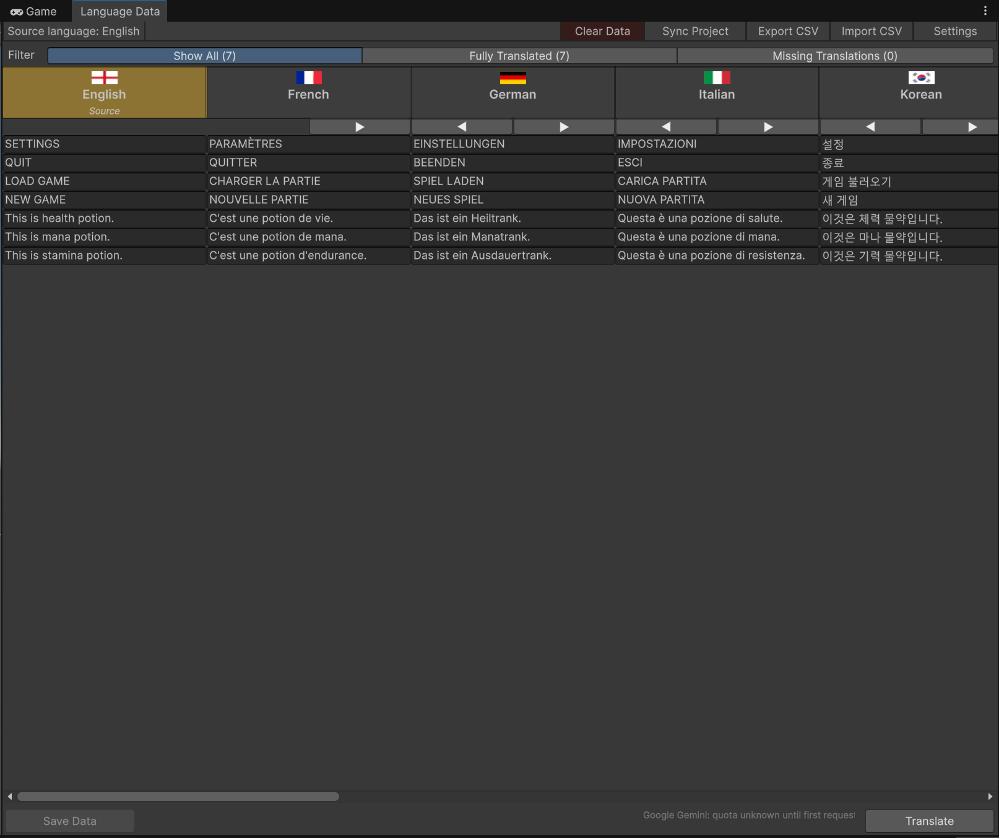

# EasyLocalize

Scan, translate, and live-switch languages in Unity — for scene text and code-driven strings alike, all from one Editor window.



## Overview

EasyLocalize finds every translatable string in your project — `Text`/`TextMeshProUGUI` components in your scenes **and** any `string` field marked with `[Localize]` in your own scripts (MonoBehaviours, ScriptableObjects, even fields nested inside plain serializable classes, or in lists of them) — and brings them all into a single Editor table.

From that table you can translate everything with one click using Gemini, OpenAI, Claude, Google Translate, or DeepL, with automatic fallback to another provider if one runs out of quota mid-run. At runtime, `LocalizedText` (and, with [UniMVC](https://github.com/fatihgezerx/UniMVC), a `LanguageDropdown` view) apply the selected language instantly and keep it in sync whenever the player switches, with the last choice remembered between sessions.

## Features

- **Two scan sources, one table** — scene `Text`/`TMP_Text` components and `[Localize]`-attributed code fields are discovered together with a single **Sync Project** button
- **Five translation providers built in** — Gemini, OpenAI, Claude, Google Translate, and DeepL, selectable per project, with automatic fallback to the next available provider when one hits its rate limit
- **Runtime language switching, no manual wiring** — every localized `Text`/`TMP_Text` updates the instant the language changes; the choice persists across sessions. With UniMVC, a ready-made `LanguageDropdown` view is added to your MVC folder
- **Rename-proof keys** — scene text keeps a stable GUID key regardless of hierarchy or renames, and code-driven strings key off their own source text, so refactors never orphan a translation
- **Filtering, CSV import/export, and virtualized rows** — filter by fully translated / missing, hand a spreadsheet to a human translator and import the results back, and browse large translation tables without Editor slowdown
- **Opt out per-object** — an `ExcludeFromLocalization` marker component keeps specific text (e.g. a Dropdown's own label) out of the scan entirely. You decide where it goes: nothing adds it for you
- **Code-filled labels left alone** — a component implementing `ILocalizedByCode` (e.g. an interaction prompt showing whichever `[Localize]` string is current through `LocalizationRuntime.Get`) tells **Sync Project** which labels it fills itself, so they get no `LocalizedText` that would overwrite them — without any component added to them. Sync only ever adds `LocalizedText` (and takes it off such labels); nothing changes on its own when entering or leaving Play Mode
- **Easy UI roles** — with [Easy UI](https://github.com/fatihgezerx/EasyUI), texts can be marked *Localization / Localized Text* or *Localization / Exclude From Localization* while designing a panel; the components are added when the panel is built

## Setup

### Requirements

- Unity 6 or newer
- uGUI and TextMeshPro (`com.unity.ugui`) — included by default
- Optional: [UniMVC](https://github.com/fatihgezerx/UniMVC), for the ready-made language dropdown
- Optional: [Easy UI](https://github.com/fatihgezerx/EasyUI), for the Localized Text / Exclude From Localization roles
- An API key for at least one translation provider (Gemini, OpenAI, Claude, Google Translate, or DeepL) if you want to use in-Editor translation

### Installation

Clone or download this repository, then copy its contents into a folder under `Assets/` (e.g. `Assets/Scripts/LocalizationSystem/`). It's self-contained via its own Runtime/Editor assembly definitions.

For the ready-made language dropdown and the Easy UI roles, a small setup script offers to install
[UniMVC](https://github.com/fatihgezerx/UniMVC) and [Easy UI](https://github.com/fatihgezerx/EasyUI) on
import (both optional). UniMVC is downloaded into `Assets/Scripts/MVC/`,
exactly as if you had copied it there. `LanguageDropdown` is then copied into your MVC folder's
`Dropdowns/` on its own: right away if UniMVC is already in the project, or as soon as UniMVC is added
later (by you or by the setup dialog). A dropdown you delete isn't brought back unless LocalizationSystem
or UniMVC is imported again. If you remove LocalizationSystem later, the dropdown stays in your project but
compiles to nothing until LocalizationSystem is imported again.

## Quick Start

1. Open **Tools > Language Data**.

2. Go to **Settings**, pick the languages your project supports, choose a translation provider, and paste its API key.



3. Back in the main table, click **Sync Project**. This scans your open scene for `Text`/`TextMeshProUGUI` components and searches your code for any field marked with `[Localize]`. Every match appears as a row, with your source language already filled in and every other language left empty:

```csharp
using LocalizationSystem;

public class ItemData : ScriptableObject
{
    [Localize] public string ItemName = "Health Potion";
    [Localize] public string ItemDescription = "Restores 50 HP.";
}
```

   A `[Localize]` field on a component sitting on a `Text`/`TMP_Text` object is taken for what that object shows, and Sync wires the object's text to it. When the string is shown somewhere else instead - e.g. a tooltip's text on a button - mark it `[Localize(ShownElsewhere = true)]`: it is still offered for translation, but the object's own text is left alone.

4. Click **Translate**. Missing translations are filled in for every language you added in step 2, then click **Save Data** to write them to disk.



5. To let players change languages at runtime with UniMVC, add the `LanguageDropdown` view (from your MVC folder's `Dropdowns/`) to a `TMP_Dropdown` under your `UIManager`. It fills itself with your project's languages and switches every localized text the moment one is picked. Without UniMVC, call `LocalizationRuntime.SetLanguage(language)` from your own UI.

6. If your own code assigns a `[Localize]`-marked string to a `Text`/`TMP_Text` yourself (instead of one already wired up by Sync Project), add a `LocalizedText` component to that object and call `SetKey` rather than assigning `.text` directly:

```csharp
label.GetComponent<LocalizedText>().SetKey(itemData.ItemName);
```

## In the editor

With the optional [Veneer](https://github.com/fatihgezerx/Veneer) in the project (the setup dialog offers to download it), **Tools > Language Data** opens a window in the shared studio look with a blue Localization System accent. A title bar with the logo carries a state pill (*Saved*, *Unsaved changes*, *Translating*). Under it: the action buttons (**Sync Project**, **Export CSV**, **Import CSV**, **Clear Data**), four counters (keys, complete, missing, languages) and two tabs.

- **Translations**: the table, drawn as a real grid: a header row (flag, language name and a *Source* badge per column) with its own background and a bottom line, thin separators between the columns and between the rows, a fixed narrow *Status* column, language columns of a fixed width (more languages than fit make the table scroll sideways, with the scroll bar just above the footer), a rounded border and a hover highlight. One row per key, one column per language, inline editing and a highlight on every empty cell. A status pill per row says *Complete* or *N missing*. Search finds keys and text; the filter chips show all, fully translated or missing rows; the *Show* chips hide language columns (view only) and *Keys* shows the internal key. The arrows in a column header move that language, the source language is pinned first. The table is virtualized, so thousands of rows stay fast.
- **Settings**: three cards. *Languages* (include a language, set the source), *Translation provider* (provider chips, the API key, a warning for languages Google Translate or DeepL cannot do) and *Game context* (genre presets, your own saved presets, the free text sent with every AI request).

The bottom bar has **Save Data** (lit while there are unsaved changes), the provider's quota and the main **Translate** button. A `LocalizedText` component shows its key's state (translated, N missing, not in table), the key and fallback text read-only, its text in every language, and a button that opens the window. `ExcludeFromLocalization` explains what the marker does.

The `LocalizedText` and `ExcludeFromLocalization` Inspectors are drawn from default layouts that Localization System ships, so they can be customised in `Tools > Veneer > Inspector Designer` (Customize makes your own copy, Reset goes back to the default). The system's own pieces (the key pill, the key hint, the translations list, the Open Language Data button) can be moved or hidden there, but not changed.

Without Veneer nothing is lost: `Tools > Language Data` is the plain IMGUI window, `LocalizedText` and `ExcludeFromLocalization` use Unity's default Inspector.

## License

This project is licensed under the [MIT License](LICENSE).
